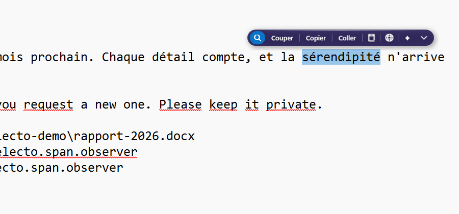
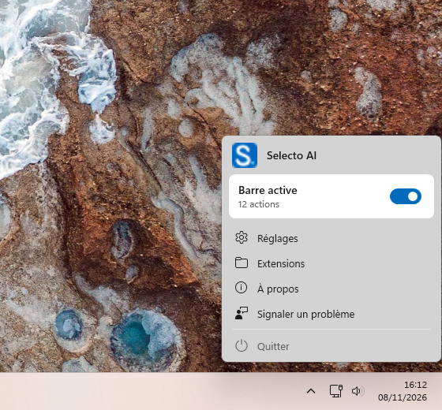
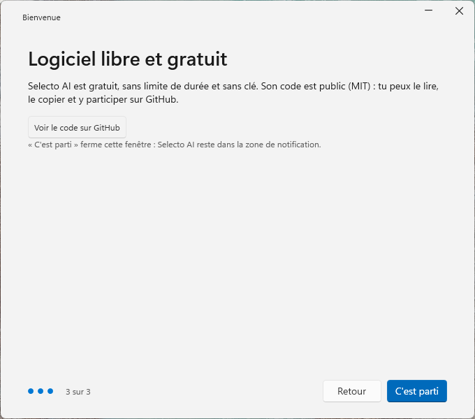

<h1 align="center">Selecto AI</h1>

<p align="center">
  Una barra de acciones flotante para Windows: selecciona texto en cualquier aplicación y tradúcelo, corrígelo, resúmelo, búscalo o conviértelo con una IA local o en línea.
</p>

<p align="center">
  <a href="LICENSE"></a>
  <a href="https://github.com/warezfr/selecto-ai/releases/latest"></a>
  <a href="https://apps.microsoft.com/detail/9P6W748ZHCWR"></a>
</p>

<p align="center">
  <a href="README.md">English</a> · <a href="README.fr.md">Français</a> · <b>Español</b>
</p>

<p align="center">
  <a href="https://selecto.span.observer/en/">Sitio web</a> ·
  <a href="https://github.com/warezfr/selecto-ai/releases/latest">Descargar</a> ·
  <a href="#uso">Uso</a> ·
  <a href="#configuración">Configuración</a> ·
  <a href="#extensiones">Extensiones</a> ·
  <a href="#compilar-desde-el-código-fuente">Compilar</a> ·
  <a href="#privacidad">Privacidad</a>
</p>

<p align="center">
  
</p>

Selecto AI está pensado para quienes pasan el día escribiendo, leyendo o traduciendo en Windows y quieren tener las acciones habituales sobre el texto junto a la selección, sin pasar por otra ventana. Funciona en cualquier aplicación, no necesita cuenta y puede ejecutar su IA en tu propio PC.

<p align="center">
  
  
</p>

<p align="center"><sub>La interfaz se muestra en francés. Selecto AI está disponible en francés, inglés, español y árabe, con diseño de derecha a izquierda para el árabe.</sub></p>

## Funciones

- Barra flotante que aparece sobre el cursor al seleccionar texto, sin tomar nunca el foco.
- Acciones integradas: buscar, abrir enlace, mostrar en el Explorador, escribir a una dirección de correo, revisar la ortografía, cortar, copiar, pegar, diccionario, traducir.
- Menú IA: resumir, explicar, reformular, corregir. Con un modelo local en tu PC (instalado desde la aplicación con Ollama, sin terminal) o con un servicio en línea y tu propia clave API (OpenAI, Anthropic, Google Gemini, Mistral, Groq, DeepSeek, xAI, Together AI, OpenRouter o cualquier endpoint compatible con OpenAI).
- Acciones de conversión y de código, y una calculadora para las expresiones seleccionadas.
- Extensiones JavaScript con una pequeña API `selecto`; este repositorio incluye una biblioteca de 22 extensiones (35 acciones).
- Atajo global (por defecto `Ctrl+Mayús+Espacio`) para mostrar la barra sobre la selección actual, por ejemplo tras seleccionar con el teclado.
- Estilos claro y oscuro, ajustes de tamaño y posición, aplicaciones y sitios excluidos.
- Cuatro idiomas: francés, inglés, español, árabe (de derecha a izquierda).
- Gratuito y de código abierto (MIT), sin cuenta.

## Instalación

Windows 10 u 11, x64 o ARM64. Sin requisitos previos: la aplicación es autónoma.

- **Releases de GitHub** ([última versión](https://github.com/warezfr/selecto-ai/releases/latest)):
  - `SelectoAI-Setup-x64-4.0.0.exe` (PC Intel/AMD) o `SelectoAI-Setup-arm64-4.0.0.exe` (PC ARM). Instalación silenciosa: `/VERYSILENT`.
  - ZIP portables (`SelectoAI-x64-portable-4.0.0.zip`, `SelectoAI-arm64-portable-4.0.0.zip`): descomprime y ejecuta `SelectoAI.exe`. Sin instalación.
- **Microsoft Store**: <https://apps.microsoft.com/detail/9P6W748ZHCWR>. Las actualizaciones llegan por la Store.

**Aviso de SmartScreen.** Los instaladores publicados en GitHub no están firmados, porque el proyecto no dispone de certificado de firma. Por eso Windows SmartScreen puede mostrar «Windows protegió su PC» y un «editor desconocido». Es lo esperado en una descarga sin firmar. Para continuar, elige «Más información» y después «Ejecutar de todas formas». Para comprobar que el archivo es el que compilamos, compara su SHA-256 con `SHA256SUMS.txt`, adjunto a la release:

```powershell
Get-FileHash .\SelectoAI-Setup-x64-4.0.0.exe -Algorithm SHA256
```

La versión de la Microsoft Store está firmada por la Store y no muestra este aviso.

## Uso

1. Inicia Selecto AI. Su icono aparece en el área de notificación y una ventana de bienvenida te guía por los primeros ajustes.
2. Selecciona texto en cualquier aplicación. La barra aparece sobre la selección sin tomar el foco.
3. Haz clic en una acción. Los resultados que no se pegan de vuelta se muestran en una pequeña ventana, desde la que puedes copiarlos.

Tras seleccionar con el teclado, pulsa `Ctrl+Mayús+Espacio` para mostrar la barra. El icono del área de notificación pausa la barra, abre los ajustes y la carpeta de extensiones, o cierra la aplicación.

## Configuración

Abre los ajustes desde el icono del área de notificación. Tienen cuatro páginas:

| Página | Qué ajustas |
| --- | --- |
| General | Inicio con Windows, atajo global, idioma de la interfaz (automático, francés, inglés, español, árabe), estilo de la barra (automático, claro, oscuro), tamaño (80 a 140 %) y posición (encima o debajo del texto), icono del área de notificación, aplicaciones y sitios excluidos. |
| Acciones | Qué acciones aparecen y en qué orden, motor de búsqueda (o una URL de búsqueda personalizada), idioma del corrector, extensiones. |
| IA | Proveedor y modelo de IA, claves API, idioma de destino de la traducción, idioma del diccionario, acciones en línea activadas o no. |
| Acerca de | Versión, actualizaciones (edición Site), enlaces, informe de problemas. |

**Proveedor de IA.** Por defecto no hay ninguna IA configurada. Elige una opción:

- **IA local**: Selecto AI instala el motor Ollama y el modelo que elijas desde los ajustes, sin terminal. El texto seleccionado no sale de tu PC.
- **Servicio en línea**: OpenAI, Anthropic, Google Gemini, Mistral, Groq, DeepSeek, xAI, Together AI u OpenRouter, con tu propia clave API. Cada clave se guarda cifrada con Windows DPAPI, nunca en texto claro.
- **Personalizado**: cualquier endpoint compatible con OpenAI (URL base, modelo, clave).

Los ajustes se guardan en `%APPDATA%\SelectoAI\settings.json`.

## Extensiones

Una extensión es un único archivo `.js` con un bloque de cabecera que la describe. Usa el objeto `selecto` (texto seleccionado, si el campo es editable, idioma, copiar, pegar, abrir, mostrar un resultado):

```js
// ==SelectoExtension==
// @identifier ai.selecto.library.slug
// @name Slug
// @description:en Create a clean slug for a web address.
// @requirements text
// @enabled-by-default true
// ==/SelectoExtension==
var r = selecto.text.toLowerCase().replace(/[^a-z0-9]+/g, "-");
if (selecto.editable) selecto.pasteText(r); else selecto.copyText(r);
selecto.showText("Done");
```

Para instalar una, usa Ajustes > Acciones > Extensiones > Añadir (acepta varios archivos `.js`, o un `.zip` con los `.js` en su raíz), o deja el archivo en `%APPDATA%\SelectoAI\Extensions\`. El menú del área de notificación incluye «Abrir la carpeta de extensiones».

Hay extensiones listas para usar en [`extensions-library/`](extensions-library/): una carpeta por extensión, con el archivo `.js` y un `meta.json`.

## Compilar desde el código fuente

Requisitos: Windows 10/11 y el [SDK de .NET 8](https://dotnet.microsoft.com/download/dotnet/8.0). La aplicación está escrita en C# / .NET 8 / WPF.

```powershell
dotnet build SelectBar.sln                      # paquete Site (por defecto)
dotnet build SelectBar.sln -p:Edition=Site      # lo mismo, explícito
dotnet build SelectBar.sln -p:Edition=Store     # paquete Microsoft Store
```

Las dos ediciones comparten el mismo código y las mismas funciones; solo cambian el empaquetado y la forma de recibir actualizaciones (`latest.json` del sitio para Site, la Store para Store).

Scripts de empaquetado (en `scripts/`):

```powershell
.\scripts\build-installer.ps1 -Arch Both        # publicación autónoma + instaladores Inno Setup en dist\installers
.\scripts\build-portable.ps1 -Arch Both         # ZIP portables en dist\portable
.\scripts\build-msix.ps1                        # paquetes MSIX de la Store en dist\msix (sin firmar, la Store los firma)
```

`build-installer.ps1` necesita [Inno Setup 6](https://jrsoftware.org/isinfo.php) (o ejecútalo con `-InstallInno` para instalarlo con winget). Más detalles en [`installer/README.md`](installer/README.md) (en francés).

La carpeta `SelectBar/` y el espacio de nombres `SelectBar` son el nombre histórico del proyecto; la aplicación y el ejecutable se llaman `Selecto AI` / `SelectoAI.exe`.

## Pruebas

```powershell
dotnet test
```

Las pruebas xUnit cubren la lógica pura (sin WPF ni Win32), así que se ejecutan sin pantalla.

## Privacidad

Selecto AI no tiene cuenta ni telemetría. El texto seleccionado se queda en tu PC hasta que lanzas una acción que necesita la red:

- **Traducir**: el texto se envía a MyMemory (`api.mymemory.translated.net`).
- **Diccionario / Explicar**: la palabra se envía a Wiktionary, dictionaryapi.dev o Wikipedia.
- **Acciones de IA con un servicio en línea**: el texto (hasta 4000 caracteres) se envía al servicio elegido, con tu clave API (cifrada con Windows DPAPI). Con la IA local (Ollama en tu PC), el texto no sale del equipo.
- **Buscar y Abrir enlace**: abren tu navegador en el motor de búsqueda o en la dirección.
- **Cálculos de divisas**: los tipos de cambio se obtienen del Banco Central Europeo.
- **Instalación de la IA local**: el motor Ollama y el modelo elegido se descargan de GitHub y del registro de Ollama, solo cuando lo pides.
- **Actualizaciones** (solo edición Site): `latest.json` se consulta en el sitio del proyecto 30 segundos después del inicio y luego cada 24 horas.
- **Informar de un problema**: solo se envía un ticket cuando lo confirmas; la captura de pantalla y los registros se adjuntan solo si así lo eliges.

Las acciones en línea (traducir, diccionario) se pueden desactivar en Ajustes > IA. Los ajustes están en `%APPDATA%\SelectoAI`. Política completa (en inglés): <https://selecto.span.observer/en/privacy/>.

## Contribuir

Las incidencias y las pull requests son bienvenidas. Lee antes [CONTRIBUTING.md](CONTRIBUTING.md). Para problemas de seguridad, consulta [SECURITY.md](SECURITY.md).

## Autor

Selecto AI está diseñado y mantenido por **EL MAHDI ZINEDDINE** ([@warezfr](https://github.com/warezfr)). Sitio web: <https://selecto.span.observer>.

## Licencia

MIT, consulta [LICENSE](LICENSE). Copyright (c) 2026 EL MAHDI ZINEDDINE.
