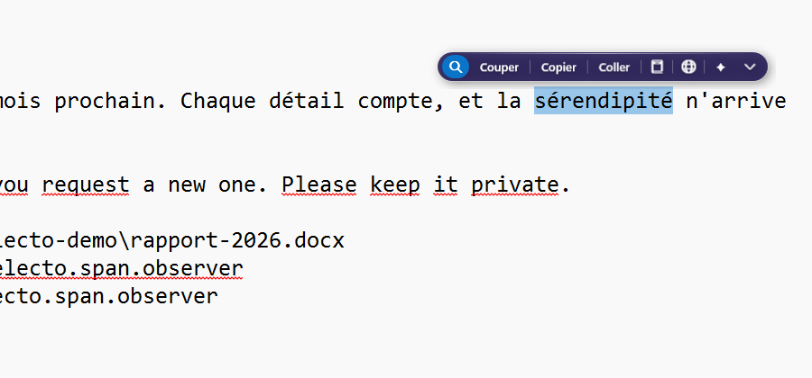
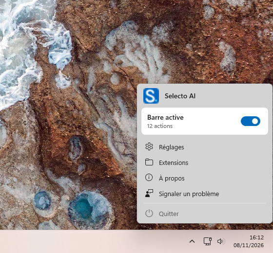
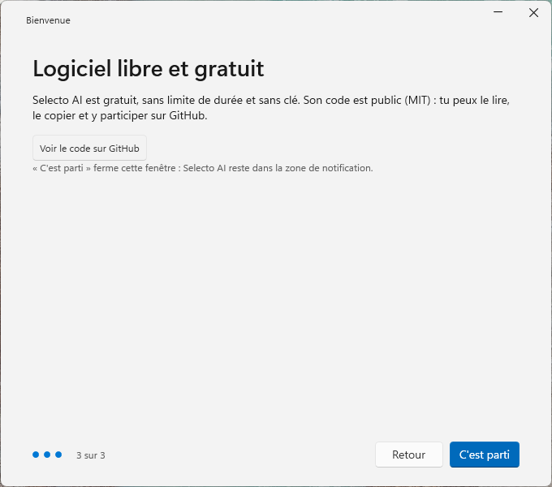

<h1 align="center">Selecto AI</h1>

<p align="center"> <sub>Fait avec fierté au Maroc 🇲🇦</sub></p>

<p align="center">
  Une barre d'actions flottante pour Windows : sélectionnez du texte dans n'importe quelle application, puis traduisez-le, corrigez-le, résumez-le, recherchez-le ou convertissez-le avec une IA locale ou en ligne.
</p>

<p align="center">
  <a href="LICENSE"></a>
  <a href="https://github.com/warezfr/selecto-ai/releases/latest"></a>
  <a href="https://apps.microsoft.com/detail/9P6W748ZHCWR"></a>
</p>

<p align="center">
  <a href="README.md">English</a> · <b>Français</b> · <a href="README.es.md">Español</a>
</p>

<p align="center">
  <a href="https://selecto.span.observer/">Site</a> ·
  <a href="https://github.com/warezfr/selecto-ai/releases/latest">Télécharger</a> ·
  <a href="#utilisation">Utilisation</a> ·
  <a href="#configuration">Configuration</a> ·
  <a href="#extensions">Extensions</a> ·
  <a href="#compiler-depuis-les-sources">Compiler</a> ·
  <a href="#confidentialité">Confidentialité</a>
</p>

<p align="center">
  <a href="https://youtu.be/sLTfm7OsbPo"></a>
  <br>
  <a href="https://youtu.be/sLTfm7OsbPo"><b>▶ Voir la démo en 1 minute</b></a>
</p>

<p align="center">
  
</p>

Selecto AI s'adresse à celles et ceux qui écrivent, lisent ou traduisent toute la journée sous Windows et veulent les actions courantes sur le texte à côté de la sélection, sans passer par une autre fenêtre. L'application fonctionne dans toutes les applications, ne demande aucun compte et peut faire tourner son IA sur votre propre PC.

<p align="center">
  
  
</p>

<p align="center"><sub>Selecto AI existe en français, anglais, espagnol et arabe, avec une mise en page de droite à gauche pour l'arabe.</sub></p>

## Fonctions

- Barre flottante qui apparaît au-dessus du curseur quand vous sélectionnez du texte, sans jamais prendre le focus.
- Actions intégrées : rechercher, ouvrir un lien, afficher dans l'Explorateur, écrire à une adresse e-mail, vérifier l'orthographe, couper, copier, coller, dictionnaire, traduire.
- Menu IA : résumer, expliquer, reformuler, corriger. Avec un modèle local sur votre PC (installé depuis l'application grâce à Ollama, sans terminal) ou un service en ligne avec votre propre clé API (OpenAI, Anthropic, Google Gemini, Mistral, Groq, DeepSeek, xAI, Together AI, OpenRouter, ou tout point d'accès compatible OpenAI).
- Actions de conversion et de code, et une calculatrice pour les expressions sélectionnées.
- Extensions JavaScript avec une petite API `selecto` ; une bibliothèque de 22 extensions (35 actions) se trouve dans ce dépôt.
- Raccourci global (par défaut `Ctrl+Maj+Espace`) pour afficher la barre sur la sélection en cours, par exemple après une sélection au clavier.
- Styles clair et sombre, réglages de taille et de position, applications et sites exclus.
- Quatre langues : français, anglais, espagnol, arabe (de droite à gauche).
- Gratuit et libre (licence MIT), sans compte.

## Installation

Windows 10 ou 11, x64 ou ARM64. Aucun prérequis : l'application est autonome.

- **Releases GitHub** ([dernière version](https://github.com/warezfr/selecto-ai/releases/latest)) :
  - `SelectoAI-Setup-x64-4.0.0.exe` (PC Intel/AMD) ou `SelectoAI-Setup-arm64-4.0.0.exe` (PC ARM). Installation silencieuse : `/VERYSILENT`.
  - ZIP portables (`SelectoAI-x64-portable-4.0.0.zip`, `SelectoAI-arm64-portable-4.0.0.zip`) : décompressez puis lancez `SelectoAI.exe`. Aucune installation.
- **Microsoft Store** : <https://apps.microsoft.com/detail/9P6W748ZHCWR>. Les mises à jour passent par le Store.

**Avertissement SmartScreen.** Les installateurs publiés sur GitHub ne sont pas signés, car le projet n'a pas de certificat de signature. Windows SmartScreen peut donc afficher « Windows a protégé votre ordinateur » et un « éditeur inconnu ». C'est normal pour un téléchargement non signé. Pour continuer, choisissez « Informations complémentaires », puis « Exécuter quand même ». Pour vérifier que le fichier est bien celui que nous avons compilé, comparez son SHA-256 avec `SHA256SUMS.txt`, joint à la release :

```powershell
Get-FileHash .\SelectoAI-Setup-x64-4.0.0.exe -Algorithm SHA256
```

La version du Microsoft Store est signée par le Store et n'affiche pas cet avertissement.

## Utilisation

1. Lancez Selecto AI. Son icône apparaît dans la zone de notification, et une fenêtre de bienvenue vous guide dans les premiers réglages.
2. Sélectionnez du texte dans n'importe quelle application. La barre apparaît au-dessus de la sélection sans prendre le focus.
3. Cliquez sur une action. Les résultats qui ne sont pas recollés s'affichent dans une petite fenêtre, d'où vous pouvez les copier.

Après une sélection au clavier, appuyez sur `Ctrl+Maj+Espace` pour afficher la barre. L'icône de la zone de notification met la barre en pause, ouvre les réglages et le dossier des extensions, ou quitte l'application.

## Configuration

Ouvrez les réglages depuis l'icône de la zone de notification. Ils comptent quatre pages :

| Page | Ce que vous réglez |
| --- | --- |
| Général | Démarrage avec Windows, raccourci global, langue de l'interface (automatique, français, anglais, espagnol, arabe), style de la barre (automatique, clair, sombre), taille (80 à 140 %) et position (au-dessus ou en dessous du texte), icône de la zone de notification, applications et sites exclus. |
| Actions | Actions affichées et leur ordre, moteur de recherche (ou adresse de recherche personnalisée), langue du correcteur, extensions. |
| IA | Fournisseur et modèle d'IA, clés API, langue cible de la traduction, langue du dictionnaire, actions en ligne activées ou non. |
| À propos | Version, mises à jour (édition Site), liens, signalement d'un problème. |

**Fournisseur d'IA.** Par défaut, aucune IA n'est configurée. Choisissez :

- **IA locale** : Selecto AI installe le moteur Ollama et le modèle choisi depuis les réglages, sans terminal. Le texte sélectionné ne quitte pas votre PC.
- **Service en ligne** : OpenAI, Anthropic, Google Gemini, Mistral, Groq, DeepSeek, xAI, Together AI ou OpenRouter, avec votre propre clé API. Chaque clé est chiffrée avec Windows DPAPI, jamais stockée en clair.
- **Personnalisé** : tout point d'accès compatible OpenAI (adresse, modèle, clé).

Les réglages sont enregistrés dans `%APPDATA%\SelectoAI\settings.json`.

## Extensions

Une extension est un simple fichier `.js` avec un bloc d'en-tête qui la décrit. Elle utilise l'objet `selecto` (texte sélectionné, champ modifiable ou non, langue, copier, coller, ouvrir, afficher un résultat) :

```js
// ==SelectoExtension==
// @identifier ai.selecto.library.slug
// @name Slug
// @description:en Create a clean slug for a web address.
// @requirements text
// @enabled-by-default true
// ==/SelectoExtension==
var r = selecto.text.toLowerCase().replace(/[^a-z0-9]+/g, "-");
if (selecto.editable) selecto.pasteText(r); else selecto.copyText(r);
selecto.showText("Done");
```

Pour en installer une, passez par Réglages > Actions > Extensions > Ajouter (plusieurs fichiers `.js` acceptés, ou un `.zip` avec les `.js` à sa racine), ou déposez le fichier dans `%APPDATA%\SelectoAI\Extensions\`. Le menu de la zone de notification propose « Ouvrir le dossier des extensions ».

Des extensions prêtes à l'emploi se trouvent dans [`extensions-library/`](extensions-library/) : un dossier par extension, avec le fichier `.js` et un `meta.json`.

## Compiler depuis les sources

Prérequis : Windows 10/11 et le [SDK .NET 8](https://dotnet.microsoft.com/download/dotnet/8.0). L'application est écrite en C# / .NET 8 / WPF.

```powershell
dotnet build SelectBar.sln                      # paquet Site (par défaut)
dotnet build SelectBar.sln -p:Edition=Site      # idem, explicite
dotnet build SelectBar.sln -p:Edition=Store     # paquet Microsoft Store
```

Les deux éditions partagent le même code et les mêmes fonctions ; elles ne diffèrent que par l'emballage et par l'arrivée des mises à jour (`latest.json` du site pour Site, le Store pour Store).

Scripts d'emballage (dans `scripts/`) :

```powershell
.\scripts\build-installer.ps1 -Arch Both        # publication autonome + installateurs Inno Setup dans dist\installers
.\scripts\build-portable.ps1 -Arch Both         # ZIP portables dans dist\portable
.\scripts\build-msix.ps1                        # paquets MSIX du Store dans dist\msix (non signés, le Store les signe)
```

`build-installer.ps1` demande [Inno Setup 6](https://jrsoftware.org/isinfo.php) (ou lancez-le avec `-InstallInno` pour l'installer via winget). Détails dans [`installer/README.md`](installer/README.md).

Le dossier `SelectBar/` et l'espace de noms `SelectBar` sont l'ancien nom du projet ; l'application et l'exécutable s'appellent `Selecto AI` / `SelectoAI.exe`.

## Tests

```powershell
dotnet test
```

Les tests xUnit couvrent la logique pure (ni WPF ni Win32) : ils tournent sans écran.

## Confidentialité

Selecto AI n'a ni compte ni télémétrie. Le texte sélectionné reste sur votre PC tant que vous ne déclenchez pas une action qui a besoin du réseau :

- **Traduire** : le texte est envoyé à MyMemory (`api.mymemory.translated.net`).
- **Dictionnaire / Expliquer** : le mot est envoyé au Wiktionnaire, à dictionaryapi.dev ou à Wikipédia.
- **Actions IA avec un service en ligne** : le texte (jusqu'à 4 000 caractères) est envoyé au service choisi, avec votre clé API (chiffrée avec Windows DPAPI). Avec l'IA locale (Ollama sur votre PC), le texte ne quitte pas la machine.
- **Rechercher et Ouvrir le lien** : ouvrent votre navigateur sur le moteur de recherche ou l'adresse.
- **Calculs de devises** : les taux de change viennent de la Banque centrale européenne.
- **Installation de l'IA locale** : le moteur Ollama et le modèle choisi sont téléchargés depuis GitHub et le registre Ollama, seulement quand vous le demandez.
- **Mises à jour** (édition Site seulement) : `latest.json` est lu sur le site du projet 30 secondes après le démarrage, puis toutes les 24 heures.
- **Signaler un problème** : un ticket n'est envoyé que quand vous le validez ; une capture et les journaux ne sont joints que si vous le choisissez.

Les actions en ligne (traduction, dictionnaire) se désactivent dans Réglages > IA. Les réglages se trouvent dans `%APPDATA%\SelectoAI`. Politique complète : <https://selecto.span.observer/confidentialite/>.

## Contribuer

Les tickets et les pull requests sont les bienvenus. Lisez d'abord [CONTRIBUTING.md](CONTRIBUTING.md). Pour un problème de sécurité, voir [SECURITY.md](SECURITY.md).

## Auteur

Selecto AI est conçu et maintenu par **EL MAHDI ZINEDDINE** ([@warezfr](https://github.com/warezfr)). Fait avec fierté au Maroc 🇲🇦. Site : <https://selecto.span.observer>.

## Licence

MIT, voir [LICENSE](LICENSE). Copyright (c) 2026 EL MAHDI ZINEDDINE.
