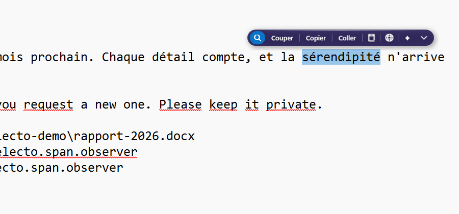
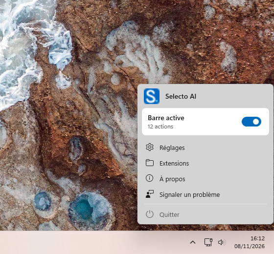
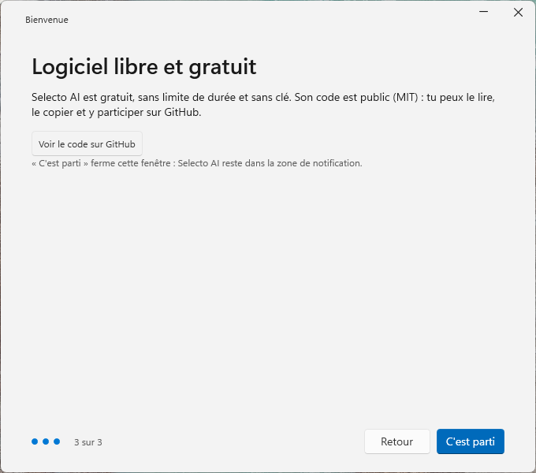

# Selecto AI

A floating action bar for Windows: select text in any app and translate, fix, summarize, search or convert it with a local or online AI.

[](LICENSE)
[](https://github.com/warezfr/selecto-ai/releases/latest)
[](https://apps.microsoft.com/detail/9P6W748ZHCWR)

Website: <https://selecto.span.observer> (English: <https://selecto.span.observer/en/>)



<p>
  
  
</p>

(The interface is shown in French. Selecto AI is available in French, English, Spanish and Arabic, with right-to-left layout for Arabic.)

## Features

- Floating bar that appears above the cursor when you select text, without ever taking focus.
- Built-in actions: search, open link, show in Explorer, write to an e-mail address, spell check, cut, copy, paste, dictionary, translate.
- AI menu: summarize, explain, rephrase, fix. Use a local model on your PC (installed from the app through Ollama, no terminal) or an online service with your own API key (OpenAI, Anthropic, Google Gemini, Mistral, Groq, DeepSeek, xAI, Together AI, OpenRouter, or any OpenAI-compatible endpoint).
- Convert and code actions, plus a calculator for selected expressions.
- JavaScript extensions with a small `selecto` API; a library of 22 extensions (35 actions) is in this repository.
- Global shortcut (default `Ctrl+Shift+Space`) to show the bar on the current selection, for example after a keyboard selection.
- Light and dark styles, size and position settings, excluded apps and sites.
- Four languages: French, English, Spanish, Arabic (RTL).
- Free and open source (MIT), no account required.

## Install

Windows 10 or 11, x64 or ARM64. No prerequisite: the app is self-contained.

- **GitHub Releases** ([latest](https://github.com/warezfr/selecto-ai/releases/latest)):
  - `SelectoAI-Setup-x64-4.0.0.exe` (Intel/AMD PCs) or `SelectoAI-Setup-arm64-4.0.0.exe` (ARM PCs). Silent install: `/VERYSILENT`.
  - Portable ZIPs (`SelectoAI-x64-portable-4.0.0.zip`, `SelectoAI-arm64-portable-4.0.0.zip`): unzip and run `SelectoAI.exe`. No installation.
- **Microsoft Store**: <https://apps.microsoft.com/detail/9P6W748ZHCWR>. Updates come from the Store.

**SmartScreen warning.** The installers published on GitHub are not code-signed, because a signing certificate is not available for this project. Windows SmartScreen may therefore show "Windows protected your PC" and an "unknown publisher". This is expected for an unsigned download. To continue, choose "More info", then "Run anyway". To check that the file is the one we built, compare its SHA-256 with `SHA256SUMS.txt` attached to the release:

```powershell
Get-FileHash .\SelectoAI-Setup-x64-4.0.0.exe -Algorithm SHA256
```

The Microsoft Store version is signed by the Store and does not show this warning.

## Extensions

An extension is a single `.js` file with a header block describing it. It uses the `selecto` object (selected text, whether the field is editable, locale, copy, paste, open, show a result):

```js
// ==SelectoExtension==
// @identifier ai.selecto.library.slug
// @name Slug
// @description:en Create a clean slug for a web address.
// @requirements text
// @enabled-by-default true
// ==/SelectoExtension==
var r = selecto.text.toLowerCase().replace(/[^a-z0-9]+/g, "-");
if (selecto.editable) selecto.pasteText(r); else selecto.copyText(r);
selecto.showText("Done");
```

To install one, either use Settings > Actions > Extensions > Add (accepts several `.js` files, or a `.zip` with `.js` files at its root), or drop the file in `%APPDATA%\SelectoAI\Extensions\`. The tray menu has an "Extensions" entry that opens that folder.

Ready-made extensions are in [`extensions-library/`](extensions-library/): one folder per extension, with the `.js` file and a `meta.json`.

## Build from source

Requirements: Windows 10/11, the [.NET 8 SDK](https://dotnet.microsoft.com/download/dotnet/8.0). The app is C# / .NET 8 / WPF.

```powershell
dotnet build SelectBar.sln                      # Site packaging (default)
dotnet build SelectBar.sln -p:Edition=Site      # same, explicit
dotnet build SelectBar.sln -p:Edition=Store     # Microsoft Store packaging
```

The two editions share the same code and features; they differ only in packaging and in how updates arrive (website `latest.json` for Site, the Store for Store).

Packaging scripts (in `scripts/`):

```powershell
.\scripts\build-installer.ps1 -Arch Both        # self-contained publish + Inno Setup installers in dist\installers
.\scripts\build-portable.ps1 -Arch Both         # portable ZIPs in dist\portable
.\scripts\build-msix.ps1                        # Store MSIX packages in dist\msix (unsigned, the Store signs them)
```

`build-installer.ps1` needs [Inno Setup 6](https://jrsoftware.org/isinfo.php) (or run it with `-InstallInno` to install it through winget). See [`installer/README.md`](installer/README.md) for details (in French).

The repository folder `SelectBar/` and the namespace `SelectBar` are the historical name of the project; the app and executable are `Selecto AI` / `SelectoAI.exe`.

## Tests

```powershell
dotnet test
```

The xUnit tests cover pure logic (no WPF or Win32), so they run without a display.

## Privacy

Selecto AI has no account and no telemetry. Selected text stays on your PC until you trigger an action that needs the network:

- **Translate**: the text is sent to MyMemory (`api.mymemory.translated.net`).
- **Dictionary / Explain**: the word is sent to Wiktionary, dictionaryapi.dev or Wikipedia.
- **AI actions with an online service**: the text (up to 4,000 characters) is sent to the service you chose, with your API key (stored encrypted with Windows DPAPI). With the local AI (Ollama on your PC), the text does not leave the machine.
- **Search and Open link**: open your browser on the search engine or the address.
- **Currency calculations**: exchange rates are fetched from the European Central Bank.
- **Local AI setup**: the Ollama engine and the model you pick are downloaded from GitHub and the Ollama registry, only when you ask for it.
- **Updates** (Site edition only): `latest.json` is fetched from the project website 30 seconds after startup and every 24 hours.
- **Report a problem**: sends a ticket only when you submit it; a screenshot and logs are included only if you choose so.

Online actions (translate, dictionary) can be turned off in Settings > AI. Settings live in `%APPDATA%\SelectoAI`. Full policy: <https://selecto.span.observer/en/privacy/>.

## Contributing

Issues and pull requests are welcome. Read [CONTRIBUTING.md](CONTRIBUTING.md) first. For security problems, see [SECURITY.md](SECURITY.md).

## License

MIT, see [LICENSE](LICENSE). Copyright (c) 2026 EL MAHDI ZINEDDINE.

## Résumé en français

Selecto AI est une application Windows gratuite et libre (licence MIT) : quand on sélectionne du texte dans
n'importe quelle application, une petite barre apparaît au-dessus du curseur. Elle permet de traduire,
corriger, résumer avec une IA locale ou en ligne, rechercher, convertir ou lancer des actions de code.
L'interface existe en français, anglais, espagnol et arabe (de droite à gauche). Le raccourci global par
défaut est Ctrl+Maj+Espace. On l'installe depuis les Releases GitHub (installateur x64 ou ARM64, ou ZIP
portable) ou depuis le Microsoft Store. Les installateurs GitHub ne sont pas signés : SmartScreen peut
afficher un avertissement, et le SHA-256 est publié dans chaque release. Les extensions sont de simples
fichiers `.js` à placer dans `%APPDATA%\SelectoAI\Extensions`. Le texte sélectionné ne quitte le PC que
lorsqu'on déclenche une action en ligne. Pour compiler : SDK .NET 8, `dotnet build SelectBar.sln`, puis
`dotnet test`. Site : https://selecto.span.observer
